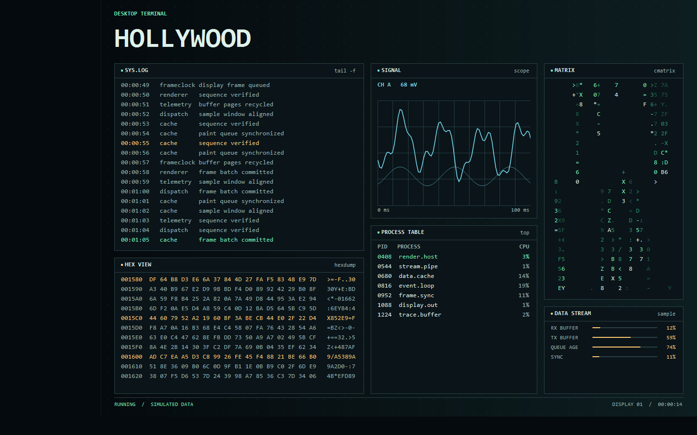

# Hollywood Desktop

[简体中文](README.md) · [English](README.en.md)

Hollywood Desktop plays cinematic terminal animations behind your Windows desktop icons. Windows still handles desktop clicks, icon dragging, and context menus. Digital rain, scrolling logs, hex dumps, waveforms, and a process table shuffle periodically. All panel data is simulated locally.



## Download and run

1. Download `HollywoodDesktop.exe` from [GitHub Releases](https://github.com/ChongYang9801/hollywood-desktop/releases/latest) and double-click it. It uses the .NET Framework 4.x included with Windows and requires no WSL, Docker, or separate runtime installation.
2. Right-click the Hollywood icon in the taskbar notification area. The menu lets you **Pause animation** (`暂停动画`), **Resume animation** (`继续动画`), or **Shuffle panels** (`重排终端面板`). If the icon is hidden, open the `^` overflow menu.
3. Choose **Exit and restore wallpaper** (`退出并恢复壁纸`) to remove the animation and reveal your existing wallpaper. You can also exit by running `./HollywoodDesktop.exe --stop` in PowerShell.

The app was tested on Windows 11 with two monitors. If Windows animation effects are disabled, the wallpaper starts paused. You can resume it from the tray menu. The app tries to reattach if Explorer rebuilds the desktop layer. If it cannot find a usable wallpaper layer at startup, it displays a message and exits.

## Build from source

Open PowerShell in the repository directory and run the following command. The script uses the C# compiler included with Windows and writes `HollywoodDesktop.exe` to the same directory.

```powershell
powershell -NoProfile -File .\Build.ps1
```

## Credits

The terminal effects were inspired by Dustin Kirkland's [Hollywood](https://github.com/dustinkirkland/hollywood).
