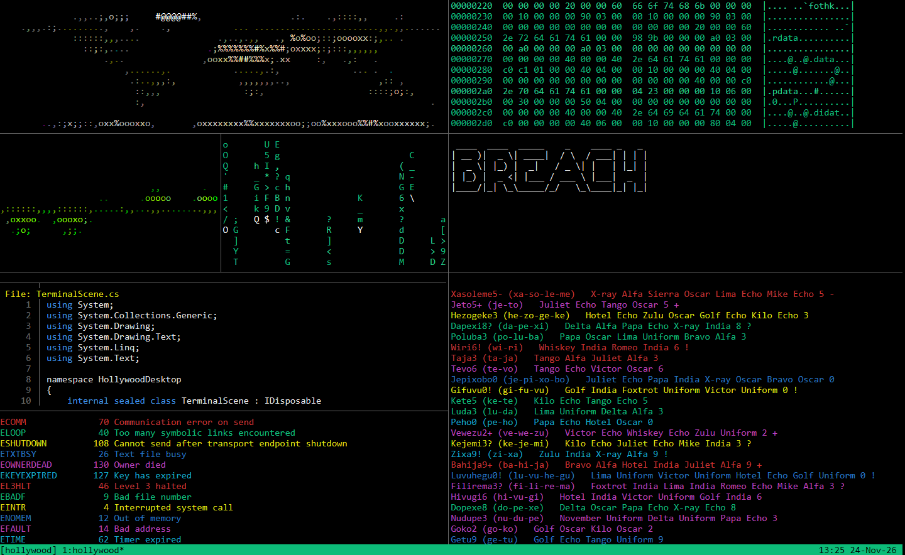

# Hollywood Desktop

[简体中文](README.md) · [English](README.en.md)

Hollywood Desktop 是 [Dustin Kirkland 的 Hollywood](https://github.com/dustinkirkland/hollywood) 的非官方 Windows 移植。它保留随机分屏和 20 个原版组件的用途，可在 Windows 终端播放，也可在桌面图标后方作为动态壁纸播放。



## 下载与使用

1. 从 [GitHub Releases](https://github.com/ChongYang9801/hollywood-desktop/releases/latest) 下载 `HollywoodDesktop.exe`，双击启动壁纸。它使用 Windows 自带的 .NET Framework 4.x，无需安装 WSL、Docker、`tmux` 或额外运行时。
2. 在任务栏通知区域右键单击 Hollywood 图标，可以**暂停动画**、**继续动画**或**重排终端面板**。如果没看到图标，展开任务栏上的 `^`。
3. 选择**退出并恢复壁纸**，即可撤下动画并显示原有壁纸。也可以在 PowerShell 里运行 `./HollywoodDesktop.exe --stop` 退出。

程序已在 Windows 11 双屏环境验证。桌面图标的点击、拖动和右键由 Windows 处理。系统关闭动画效果时，壁纸会以暂停状态启动，可以从托盘继续播放。如果 Explorer 重建桌面层级，程序会尝试重新挂载。

## 终端模式和参数

在 Windows Terminal 的 PowerShell 中运行，按 `Ctrl+C` 退出。

```powershell
Start-Process -FilePath .\HollywoodDesktop.exe -ArgumentList '--terminal', '-s', '8', '-d', '10' -NoNewWindow -Wait
```

`-s` 或 `--splits` 设置最大面板数，默认取逻辑处理器数的两倍与 20 中较小的值。`-d` 或 `--delay` 设置重排间隔，默认 10 秒。去掉 `--terminal` 就会以同样的参数启动壁纸。

## 原版组件在 Windows 上的输出

| 原版组件 | Windows 版数据与呈现 |
| --- | --- |
| `map`、`mplayer`、`figlet` | 原版世界地图、声波视频的 ASCII 帧，以及原版词表的 FIGlet Standard 字样 |
| `cmatrix`、`apg`、`pv`、`sshart` | 数字雨、可读音节的随机字符串、10 MiB 随机字节进度、SHA-256 指纹图。Windows OpenSSH 可用时，指纹来自临时生成的 Ed25519 密钥 |
| `atop`、`htop`、`bmon`、`speedometer` | 真实的 Windows CPU、内存、进程和网卡计数器。`bmon` 在窄面板中降级为 `speedometer` |
| `bat`、`code`、`errno`、`hexdump` | 带高亮的移植源码和上游脚本、Linux 错误名和编号、Windows 系统二进制文件的十六进制输出 |
| `jp2a`、`logs`、`man`、`stat`、`tree` | Windows 自带图片、系统及应用程序事件日志、Windows 命令帮助、系统文件元数据和目录树 |

移植版保留原版的终端面板和内容类型。系统类面板读取当前 Windows 主机，Linux 与 Windows 上看到的日志、进程、路径和帮助文本会不同。

## 从源码构建

在仓库目录打开 PowerShell，运行以下命令。脚本会调用 Windows 自带的 C# 编译器，在同一目录生成 `HollywoodDesktop.exe`。

```powershell
powershell -NoProfile -File .\Build.ps1
```

## 致谢

以 [Hollywood 上游提交 `b715325`](https://github.com/dustinkirkland/hollywood/tree/b715325107cb3f54f77831c3a9d23adcdfe8de1d) 为移植参考。上游素材和第三方署名见 [许可证](LICENSE) 和 [第三方声明](THIRD-PARTY-NOTICES.txt)。可执行文件中的许可证可以从托盘菜单打开。
